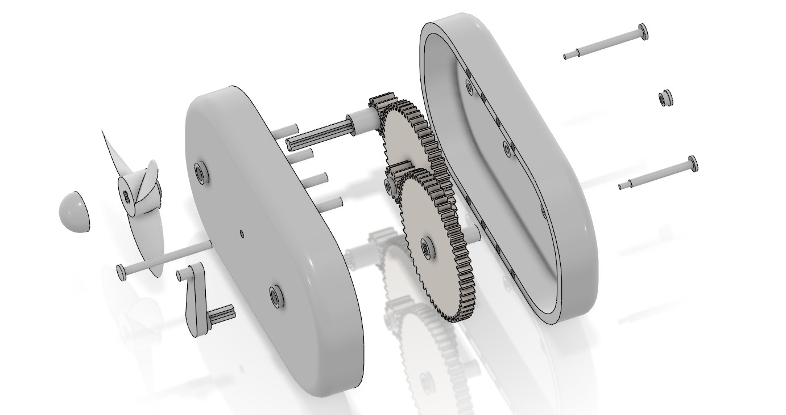
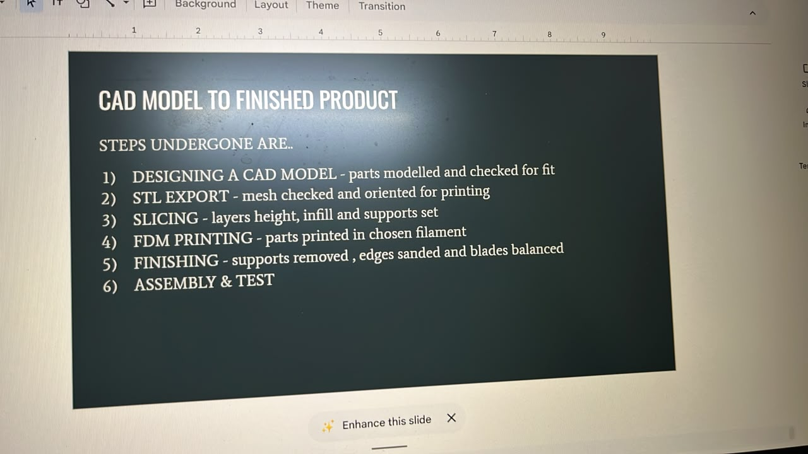

# MT PROJECT — 3D Printed Handheld Fan

Manufacturing Technology project: design and additive manufacture (FDM) of a
**hand-cranked, gear-driven handheld fan** with no motor or battery. A crank turns a
54-tooth spur gear that drives a compound gear (12 T + 54 T), which drives a 12-tooth
pinion on the propeller shaft, so the propeller turns about 20 times per crank turn
(theoretical, from the CAD tooth counts).

## Animation: "CAD Model to Finished Product" (180 s)

| Deliverable | Path |
|---|---|
| **Final video** (1920×1080, 30 fps, H.264 + AAC, 180.0 s) | `output/hand_cranked_fan_animation_180s.mp4` |
| Source audit (what was checked, contradictions, assumptions) | `output/source_audit.md` |
| Storyboard / scene timeline | `output/storyboard.md`, `output/timeline.csv` |
| Narration script, audio and captions | `output/narration_script.md`, `output/narration_audio.wav`, `output/captions.srt` |
| Asset credits | `output/asset_credits.md` |
| QA report | `output/qa_report.md` |
| Interactive companion (offline single HTML file) | `output/interactive_companion/fan_interactive_companion.html` |

### Rebuilding the animation (`animation/`)

| Step | Script | Output |
|---|---|---|
| 1 | `pipeline/01_convert_cad.py` | IGES → 12 render meshes, 12 STL files, `fan_assembly.glb` (needs `cadquery-ocp trimesh`) |
| 2 | `pipeline/02_narration.py <kokoro_dir>` | Narration clips, schedule, `narration_audio.wav`, `captions.srt` (needs `kokoro-onnx`, model from the kokoro-onnx GitHub release) |
| 3 | `pipeline/03_slice_parts.py` | Toolpaths for every part in the report's orientations (needs `shapely networkx`) |
| 4 | `pipeline/04_render_frames.mjs <dir> [workers]` | 5400 JPEG frames via Three.js in headless Chromium (`npm install`, Playwright) |
| 5 | `pipeline/05_audio_mix.py` | Synthesised effects and music bed mixed under the narration |
| 6 | `pipeline/06_write_docs.py` | `timeline.csv`, `narration_script.md` |
| 7 | `pipeline/07_encode.sh <dir>` | The final MP4 |
| QA | `pipeline/preview.mjs`, `pipeline/qa_asr.py` | Frame contact sheets; Whisper transcription check of the narration |

The scenes live in `animation/web/js/scenes/` (one file per stage). Every frame is a pure function of time, so any range can be re-rendered.
`npm run serve` then opening `http://127.0.0.1:8123/` shows the render page; call `renderFrame(t)` in the console to scrub.

## Repository contents

| Path | Description |
|------|-------------|
| `cad/fan_A.1.igs` | Full CAD assembly in IGES format (exported from 3DEXPERIENCE / CATIA V6R2026x, units: mm) |
| `docs/Manufacturing_Technology_Project_Report_3D_Printed_Handheld_Fan.pdf` | Project report (10 pages) |
| `docs/Handheld_3D_Printed_Fan.pptx` | Presentation slides (generic electric-fan template; see the source audit) |
| `images/` | Exploded-view renders and the process slide |
| `MT-PROJECT.zip` | The original upload, from which `cad/`, `docs/` and `images/` were extracted |

## Components (names as in the project; counts from the CAD)

| Component | Function | Qty |
|-----------|----------|-----|
| Shell half (front, with pin bosses) | Holds the gear train and forms the grip | 1 |
| Shell half (back, with locating pins) | Closes the body and aligns the halves | 1 |
| Crank handle | Input; converts hand motion to rotation | 1 |
| Large spur gear (54 T) and crank shaft | First stage of the speed-up | 1 + 1 |
| Compound gear (12 T + 54 T) | Intermediate stage (present in the CAD) | 1 |
| Pinion (12 T) with hub, and propeller shaft | Final stage; carries the propeller | 1 + 1 |
| Propeller | Produces the airflow | 1 |
| Propeller cap | Retains the propeller on the shaft (shown in the renders; not in the IGES export) | 1 |
| Axle pins | Support the gears inside the body | 3 |

## CAD model to finished product

1. **Designing a CAD model**: parts modelled and checked for fit
2. **STL export**: mesh checked and oriented for printing
3. **Slicing**: layer height, infill and supports set
4. **FDM printing**: parts printed in the chosen filament
5. **Finishing**: supports removed, edges sanded and blades balanced
6. **Assembly & test**

